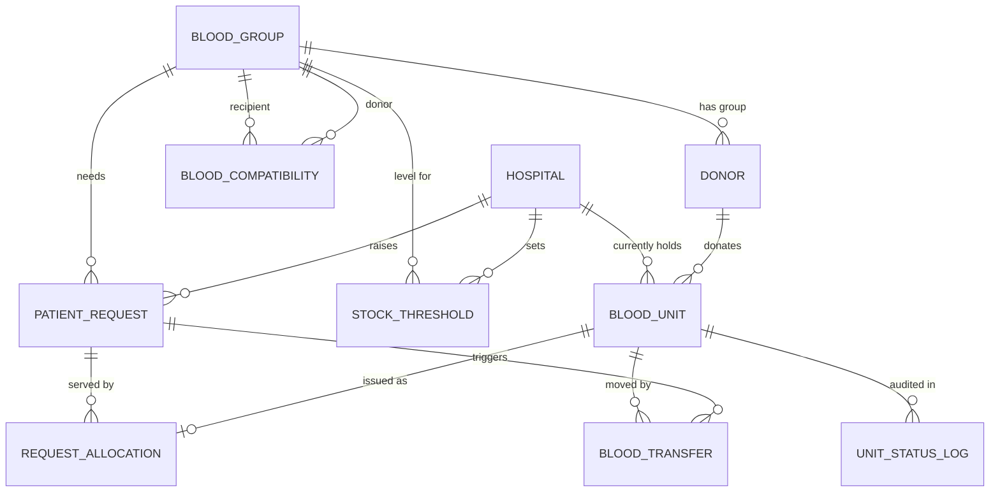

# Real-Time Blood Inventory and Expiry-Aware Allocation Across a Hospital Network

Oracle SQL / PL/SQL project (12c or later). Tested logic targets Oracle XE 21c, Live SQL, or any 12c+ instance.

## Files and run order

| # | File | What it does |
|---|------|--------------|
| 1 | `01_schema.sql` | 11 tables, constraints, indexes (re-runnable) |
| 2 | `02_config_triggers_scheduler.sql` | Config package, expiry/status/compatibility triggers |
| 3 | `03_procedures.sql` | FEFO allocation, transfers, donation intake, expiry sweep, hourly scheduler job |
| 4 | `04_views.sql` | Dashboards: stock, shortage/surplus, expiring soon, wastage, fulfilment time |
| 5 | `05_seed_data.sql` | Blood groups, compatibility matrix, 4 hospitals, 40 donors, 250 units, 15 requests |
| 6 | `06_tests.sql` | Test scenarios T0-T7 with PASS/FAIL output (wipes transactional data) |
| 7 | `07_concurrency_test.py` | 25 real parallel DB sessions fighting for 20 units |

In SQL*Plus / SQL Developer: run `@01_schema.sql` ... `@06_tests.sql` in order. The scheduler job needs `GRANT CREATE JOB TO your_user;` (run once as DBA). If you can't get that privilege, comment out the last block of file 3 and call `EXEC sweep_expiry;` manually.

## ER diagram

## Why it is in 3NF

* **1NF** - all columns atomic, every table has a primary key.
* **2NF** - tables with composite keys (`blood_compatibility`, `stock_threshold`) have no non-key columns that depend on part of the key.
* **3NF** - no non-key column depends on another non-key column. The key design decision: `blood_unit` has **no** `group_id`. A unit's group is determined by its donor (`donor_id -> group_id`), so storing it on the unit would be a transitive dependency. Group is obtained by joining through `donor`; the index `ix_donor_group` keeps that join cheap.
* **Known, documented trade-off:** `expiry_date` is derivable from `collection_date + shelf life`. It is filled by a trigger and stored so it can be indexed for FEFO ordering (the hottest query). State this in your viva as a deliberate controlled redundancy.
* Request progress (`units fulfilled`) is **not** stored; it is computed from `request_allocation`, avoiding update anomalies.

## How each problem-statement goal is met

**Expiry management** - `trg_blood_unit_biu` recalculates AVAILABLE / NEAR_EXPIRY / EXPIRED on every write and blocks illegal transitions (an expired or issued unit can never be reopened or issued). `sweep_expiry`, run hourly by `DBMS_SCHEDULER`, catches units whose status went stale simply because time passed, and logs each run in `expiry_sweep_log`.

**Safe allocation** - `allocate_request` matches compatible groups through `blood_compatibility` (27 rows, generated by the ABO/Rh rule), orders candidates by `expiry_date` (FEFO), prefers an exact group match on ties (saves O- for those who need it), and falls back to network transfers when the local hospital cannot cover the request. `trg_allocation_compat` re-checks compatibility at the database level even for hand-written inserts.

**Concurrency and integrity** - three layers:
1. `SELECT ... FOR UPDATE SKIP LOCKED` on each candidate unit (`try_lock_unit`): a competing session skips locked units instead of waiting or deadlocking.
2. Status re-check after the lock is taken (the unit may have changed between the scan and the lock).
3. `UNIQUE(unit_id)` on `request_allocation` as a last line of defence, plus a unique partial index allowing only one open transfer per unit.
The procedures never `COMMIT` internally; the caller controls the transaction, so a failure rolls back the whole allocation (atomicity).

**Network-wide visibility** - `v_hospital_stock`, `v_open_demand`, `v_shortage_surplus` (SHORTAGE / OK / SURPLUS against per-hospital min/max levels), `v_network_summary`, `v_expiring_soon`, `v_wastage_report`, `v_request_fulfilment`. All use `expiry_date > SYSDATE` so they stay correct between sweeps. The index `ix_unit_fefo (hospital_id, status, expiry_date)` serves the FEFO scan; `EXPLAIN PLAN` at the end of `06_tests.sql` demonstrates it.

## Evaluation (what to report)

| Claim | Evidence |
|-------|----------|
| FEFO reduces wastage | T7: identical data, 70 requests, FIFO vs FEFO; count of units about to expire unused (FEFO should be lower) |
| Shortage solved by network | T5 plus `v_shortage_surplus` before/after |
| No double issue under concurrency | T6 (deterministic) and `07_concurrency_test.py` (25 real sessions) |
| Integrity | T3 (expired / illegal transition / incompatible allocation all rejected) |
| Expiry automation | T4 (sweep), T3a (trigger) |
| Faster fulfilment | `v_request_fulfilment.minutes_to_fulfil`: automated allocation resolves in seconds; compare with a manual phone-around process in your discussion |

Paste the PASS/FAIL output, the T7 numbers and the dashboard result sets into your report as screenshots.

## Suggested report outline

1. Problem statement and motivation (wastage next to shortage)
2. Requirements and assumptions (42-day shelf life, 7-day near-expiry window, 90-day donation gap, red-cell compatibility only)
3. ER diagram and relational schema
4. Normalisation walkthrough (1NF -> 3NF, the `group_id` decision)
5. Implementation: triggers, procedures, scheduler, views, indexes
6. Concurrency design (lock strategy diagram: scan -> try lock -> re-check -> issue)
7. Test scenarios and results
8. Limitations and future work

## Likely viva questions

* *Why SKIP LOCKED instead of plain FOR UPDATE?* Plain FOR UPDATE makes the second session wait for the first to commit, then it may find the unit already gone; SKIP LOCKED lets it take the next-best unit immediately, which matters when a patient is waiting.
* *Why not store blood group on `blood_unit`?* Transitive dependency (3NF); it also prevents a unit and its donor from ever disagreeing.
* *Why both a trigger and a scheduled job?* The trigger fires only on DML; the job handles rows nobody touches while time passes.
* *What isolation level?* Oracle's default READ COMMITTED; correctness comes from explicit row locks plus the UNIQUE constraint, not from SERIALIZABLE.
* *Why doesn't the procedure commit?* So the caller can combine allocation with other work atomically.

## Extensions if you have time

Distance-aware transfer choice (add lat/long to `hospital`), platelets and plasma with their own shelf lives and compatibility rules, a reserve stock for CRITICAL requests, a materialised view for dashboards on very large data, a small web front end over the views.
