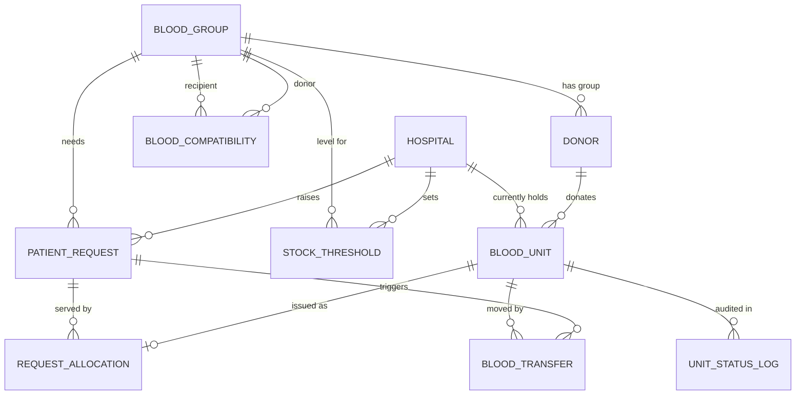

# Real-Time Blood Inventory and Expiry-Aware Allocation Across a Hospital Network

Oracle SQL / PL/SQL project (12c or later). Tested logic targets Oracle XE 21c, Live SQL, or any 12c+ instance.

## Files and run order

| # | File | What it does |
|---|------|--------------|
| 1 | `01_schema.sql` | 11 tables, constraints, indexes (re-runnable) |
| 2 | `02_config_triggers_scheduler.sql` | Config package, expiry/status/compatibility triggers |
| 3 | `03_procedures.sql` | FEFO allocation, transfers, donation intake, expiry sweep, hourly scheduler job |
| 4 | `04_views.sql` | Dashboards: stock, shortage/surplus, expiring soon, wastage, fulfilment time |
| 5 | `05_seed_data.sql` | Blood groups, compatibility matrix, 4 hospitals, 40 donors, 250 units, 15 requests |
| 6 | `06_tests.sql` | Test scenarios T0-T7 with PASS/FAIL output (wipes transactional data) |
| 7 | `07_concurrency_test.py` | 25 real parallel DB sessions fighting for 20 units |

In SQL*Plus / SQL Developer: run `@01_schema.sql` ... `@06_tests.sql` in order. The scheduler job needs `GRANT CREATE JOB TO your_user;` (run once as DBA). If you can't get that privilege, comment out the last block of file 3 and call `EXEC sweep_expiry;` manually.

## ER diagram



## Why it is in 3NF

* **1NF** - all columns atomic, every table has a primary key.
* **2NF** - tables with composite keys (`blood_compatibility`, `stock_threshold`) have no non-key columns that depend on part of the key.
* **3NF** - no non-key column depends on another non-key column. The key design decision: `blood_unit` has **no** `group_id`. A unit's group is determined by its donor (`donor_id -> group_id`), so storing it on the unit would be a transitive dependency. Group is obtained by joining through `donor`; the index `ix_donor_group` keeps that join cheap.
* **Known, documented trade-off:** `expiry_date` is derivable from `collection_date + shelf life`. It is filled by a trigger and stored so it can be indexed for FEFO ordering (the hottest query). State this in your viva as a deliberate controlled redundancy.
* Request progress (`units fulfilled`) is **not** stored; it is computed from `request_allocation`, avoiding update anomalies.

## How each problem-statement goal is met

**Expiry management** - `trg_blood_unit_biu` recalculates AVAILABLE / NEAR_EXPIRY / EXPIRED on every write and blocks illegal transitions (an expired or issued unit can never be reopened or issued). `sweep_expiry`, run hourly by `DBMS_SCHEDULER`, catches units whose status went stale simply because time passed, and logs each run in `expiry_sweep_log`.

**Safe allocation** - `allocate_request` matches compatible groups through `blood_compatibility` (27 rows, generated by the ABO/Rh rule), orders candidates by `expiry_date` (FEFO), prefers an exact group match on ties (saves O- for those who need it), and falls back to network transfers when the local hospital cannot cover the request. `trg_allocation_compat` re-checks compatibility at the database level even for hand-written inserts.

**Concurrency and integrity** - three layers:
1. `SELECT ... FOR UPDATE SKIP LOCKED` on each candidate unit (`try_lock_unit`): a competing session skips locked units instead of waiting or deadlocking.
2. Status re-check after the lock is taken (the unit may have changed between the scan and the lock).
3. `UNIQUE(unit_id)` on `request_allocation` as a last line of defence, plus a unique partial index allowing only one open transfer per unit.
The procedures never `COMMIT` internally; the caller controls the transaction, so a failure rolls back the whole allocation (atomicity).

**Network-wide visibility** - `v_hospital_stock`, `v_open_demand`, `v_shortage_surplus` (SHORTAGE / OK / SURPLUS against per-hospital min/max levels), `v_network_summary`, `v_expiring_soon`, `v_wastage_report`, `v_request_fulfilment`. All use `expiry_date > SYSDATE` so they stay correct between sweeps. The index `ix_unit_fefo (hospital_id, status, expiry_date)` serves the FEFO scan; `EXPLAIN PLAN` at the end of `06_tests.sql` demonstrates it.

## Web console (local front end)

`webapp/` is a small browser front end over the procedures and views: dashboards, inventory, donor registration and donations, patient requests with FEFO allocation, transfers, and the expiry sweep. It runs on the machine that hosts the database and listens on `127.0.0.1` only, so it is not reachable from any other computer.

```
cd webapp
pip install -r requirements.txt
python server.py
```

It asks for the Oracle username and password at start-up (or reads `ORA_USER` / `ORA_PWD` / `ORA_DSN`, default DSN `localhost/XEPDB1`), then opens http://127.0.0.1:5000. Run `01`-`05` first. Note that `06_tests.sql` wipes the units and requests the console shows.
